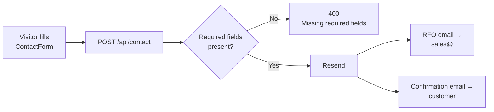

# aero

Marketing and quote-request website for **AeroJim Energy Supply Solutions**, a wholesale supplier of oil and gas accessories, parts, and ancillaries for upstream and downstream equipment.

Visitors browse a catalogue of ten equipment categories and submit a request for quotation (RFQ); the site emails the enquiry to the sales team and sends the customer an automatic confirmation.


---

## Contents

- [Repository layout](#repository-layout)
- [Tech stack](#tech-stack)
- [Getting started](#getting-started)
- [Environment variables](#environment-variables)
- [Pages](#pages)
- [Product catalogue](#product-catalogue)
- [The RFQ flow](#the-rfq-flow)
- [Deployment](#deployment)
- [Known issues](#known-issues)

---

## Repository layout

> **Note:** the application does not live at the repository root. It sits one level down, in `aerojim/`. Every command below assumes you have `cd`'d into that directory first.

```text
aero/
└── aerojim/                    ← the Next.js application
    ├── src/
    │   ├── app/
    │   │   ├── layout.tsx           # Root layout: Navbar, Footer, site metadata
    │   │   ├── page.tsx             # Home
    │   │   ├── about/page.tsx
    │   │   ├── contact/
    │   │   │   ├── page.tsx
    │   │   │   └── ContactForm.tsx  # Client-side RFQ form
    │   │   ├── products/
    │   │   │   ├── page.tsx         # Category index
    │   │   │   └── [category]/page.tsx
    │   │   ├── api/contact/route.ts # POST handler — sends both emails
    │   │   └── globals.css
    │   ├── components/
    │   │   ├── Navbar.tsx
    │   │   └── Footer.tsx
    │   └── lib/
    │       └── products.ts          # The full product catalogue
    ├── public/
    ├── next.config.ts
    └── package.json
```

---

## Tech stack

| Concern | Choice |
| --- | --- |
| Framework | Next.js 16 (App Router) |
| UI | React 19 |
| Language | TypeScript 5 |
| Styling | Tailwind CSS 4 (via `@tailwindcss/postcss`) |
| Icons | `lucide-react` |
| Transactional email | [Resend](https://resend.com) |
| Linting | ESLint 9 with `eslint-config-next` |

---

## Getting started

### Prerequisites

- Node.js 18.18 or later
- npm

### Installation

```bash
git clone https://github.com/imostack/aero.git
cd aero/aerojim
npm install
```

### Running locally

```bash
npm run dev
```

The site is served at <http://localhost:3000>.

### Scripts

| Script | What it does |
| --- | --- |
| `npm run dev` | Start the development server |
| `npm run build` | Production build |
| `npm run start` | Serve the production build |
| `npm run lint` | Run ESLint |

---

## Environment variables

Create `aerojim/.env.local`:

```bash
RESEND_API_KEY=re_your_key_here
```

| Variable | Required | Purpose |
| --- | --- | --- |
| `RESEND_API_KEY` | Yes, for the contact form | Authenticates with Resend to send the RFQ and confirmation emails |

Without it, every page still renders, but `POST /api/contact` will fail.

The sending and receiving addresses are currently hardcoded in `src/app/api/contact/route.ts`:

| Role | Address |
| --- | --- |
| Internal notification, from | `enquiries@mail.aerojim.com` |
| Internal notification, to | `sales@mail.aerojim.com` |
| Customer confirmation, from | `noreply@mail.aerojim.com` |

The `mail.aerojim.com` domain must be verified in your Resend account for delivery to succeed.

> **Never commit `.env.local`.** It holds a live API key.

---

## Pages

| Route | Purpose |
| --- | --- |
| `/` | Home |
| `/about` | Company background |
| `/products` | All ten equipment categories |
| `/products/[category]` | Items within one category |
| `/contact` | RFQ form |

---

## Product catalogue

`src/lib/products.ts` is the single source of truth for the catalogue — there is no CMS or database. Adding a product means editing that file.

| Category | Slug |
| --- | --- |
| Valves | `valves` |
| Wellhead & Christmas Tree Equipment | `wellhead` |
| Flanges & Fittings | `flanges-fittings` |
| Pipes, Casing & Tubing | `pipes-tubing` |
| Pressure Control | `pressure-control` |
| Flow Measurement | `flow-measurement` |
| Pumps & Compressors | `pumps-compressors` |
| Safety Equipment | `safety-equipment` |
| Seals & Gaskets | `seals-gaskets` |
| Structural Hardware | `structural-hardware` |

Each category carries a list of named products — gate, ball, globe, check, butterfly, safety/relief, needle, and plug valves under Valves, for example.

---

## The RFQ flow



The form collects name, company, email, phone, country, category, product, quantity, and a free-text message. **Name, company, email, country, and product are required**; the rest are optional and render as an em dash when omitted.

Both emails are sent concurrently with `Promise.all`. The internal notification sets `replyTo` to the customer's address, so replying from the sales inbox reaches them directly. If either send fails, the endpoint returns `500`.

---

## Deployment

The project is a standard Next.js app and deploys to [Vercel](https://vercel.com) without configuration changes — with one caveat: **set the project's root directory to `aerojim`**, since the app is not at the repository root.

Add `RESEND_API_KEY` to the project's environment variables before deploying.

---

## Known issues

- **Unescaped user input in outbound email.** `src/app/api/contact/route.ts` interpolates form fields straight into an HTML email template. A submitted value containing HTML is rendered as markup in the sales inbox and in the customer's confirmation. Escaping the values before interpolation would close this.
- **No rate limiting on `/api/contact`.** The endpoint can be submitted repeatedly, which costs Resend quota and floods the sales inbox. A CAPTCHA or per-IP throttle would help.
- **Nested project directory.** Having the app in `aerojim/` rather than at the root means tooling, CI, and deploy targets all need the extra path configured. Consider flattening it.
- **Local editor and agent configuration is committed** — `.claude/settings.local.json` at the root, and `CLAUDE.md` / `AGENTS.md` inside `aerojim/`. These are personal tooling files and belong in `.gitignore`.
- **The root `README.md` is a stub**, and `aerojim/README.md` is still the unmodified `create-next-app` boilerplate.

---

## License

No license has been specified for this repository. Without one, default copyright applies and others have no permission to reuse the code.
